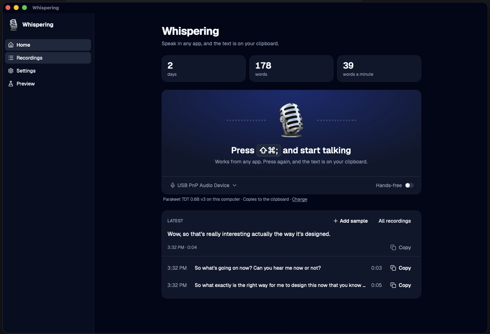

# Whispering

Press a shortcut, speak, and get the text on your clipboard, or pasted
where you are typing. Whispering
records on your device, transcribes there too with a model it downloads
once, or with a transcription server you choose, can have a chat model
clean up the text, and keeps every recording and transcript as files you
can open.



It runs in two places from the same page: a desktop app (Tauri) and a
browser tab. Only the desktop app transcribes on the device; a browser tab
needs a server.

```bash
bun dev:whispering           # the page in a browser, on port 1420
bun dev:whispering:desktop   # the desktop app
```

Run both from the repository root.

The desktop app's program also transcribes a file from a terminal, with no
window, using a model already downloaded. Another program runs it this way
to use Whispering as its transcription engine:

```bash
whispering --transcribe-file talk.m4a --json   # {"text": ..., "model": ...}
whispering --transcribe-file talk.m4a --model "whisper small"
whispering --list-models
```

## What it stores

The desktop app keeps its files in the app's local data directory. A browser
keeps the same files in its Origin Private File System, which belongs to the
page's origin and is not visible in Finder. Whispering asks the browser to
keep them when space runs low (`navigator.storage.persist()`); a browser
that says no may clear them.

```txt
settings.json           one key per setting: what transcribes, the microphone, shortcuts, output, cleanup
dictionary.txt          words to spell as written, and `heard -> written` fixes
cleanup.md              your own cleanup prompt; without it, the built-in one
recordings/<id>.md      the note: the text you got as the body; front matter holds
                        durationMs, and `original` when cleanup changed the text
recordings/<id>.webm    the audio (.m4a when the recorder made MP4)
```

A recording's id starts with the time it began, so a list of files sorts by
time and a recording whose note never got written still has a time.

A model's file is not here either: it is in the Hugging Face cache
(`~/.cache/huggingface/hub`), which other apps on the computer share.

No server's API key is in these files. The desktop app
keeps it in the macOS Keychain; a browser keeps it in `localStorage`.

## Code layout

Each layer imports only from the layers below it.

```txt
src/
  app.css                    the shared Epicenter styles, then Whispering's own colors
  routes/                    screens: read through queries, write through mutations
    +layout.svelte           what every window shares: the stylesheet
    Pill.svelte              the floating pill, shared by its window and the preview
    pill/                    the pill's own window; shows what the main window sends
    (app)/                   the main window (a route group: no part of any address)
      +layout.svelte         the sidebar frame; hands the screens the real dictation
      +page.svelte           Home: the recorder or the first run, what dictation needs, the latest take
      recordings/            the list and the reading pane, chosen by `?id=`
      Page.svelte            a page that scrolls as one column, under its name
      PageHeader.svelte      a page's name and the line under it
      settings/<section>/    one page per settings section, built of SettingsSection and SettingsRow
      preview/               development only: the screens fed a made-up dictation
  lib/
    dictation-view.ts        what a screen may know about dictation (`DictationView`)
    dictation.svelte.ts      live state, hands-free, and record → save → transcribe → clean up → deliver
    queries.ts               the cache: TanStack Query over data/, keys, models, and microphones
    model-downloads.svelte.ts  how far each model download is, for any screen
    data/
      recordings.ts          the rules for recordings/ (no cache)
      settings.ts            the rules for settings.json (no cache)
      text-files.ts          dictionary.txt and cleanup.md, read and written whole (no cache)
    platform/
      index.ts               chooses desktop or browser, once
      files/                 files.ts (contract), tauri.ts, opfs.ts
      recorder/              recorder.ts (contract), native.ts, browser.ts
      servers/               servers.ts (contract), native.ts, browser.ts
      shortcuts/             shortcuts.ts (contract), native.ts, browser.ts: keys that work from any app
      paste/                 paste.ts (contract), native.ts, browser.ts: the paste keys, in the app in front
      media/                 media.ts (contract), native.ts, browser.ts: pausing music for a take
      autostart/             autostart.ts (contract), native.ts, browser.ts: opening at login
      local/                 local.ts (contract), native.ts, browser.ts: models on this computer
      pill/                  pill.ts (contract), native.ts, browser.ts: the two windows talking
    cleanup.ts               pure rules: the dictionary, when cleanup runs, what it is told
    shortcut.ts              pure rules: a shortcut's keys from a key press, and as a person reads them
    shortcut-holds.svelte.ts which shortcuts are held now, and why one is not
    sounds.ts                the notes that mark a take starting and ending
    languages.ts             the languages a person can say they dictate in
    loudness.ts              a microphone's level as how loud it sounds, for every meter
    feed.ts                  pure rules: a recording's time, day, search match, and how much was dictated
    transcription-server.ts  the server's address and model, and presets
src-tauri/src/
  cli.rs                     `--transcribe-file` and `--list-models`: a transcript from a terminal, with no window
  files.rs                   reads many files in one call, sizes a directory, opens the folder
  keys.rs                    the Keychain
  servers.rs                 transcription and cleanup requests, with the key
  local.rs                   transcribes a recording with a model on this computer
  pill.rs                    the pill's window: a panel over every app that never takes focus
  shortcuts.rs               holds the global shortcuts the page names
  paste.rs                   presses the paste keys, when macOS allows it
  autostart.rs               asks the system to open Whispering at login
  media.rs, media/           pauses and resumes the system's media, per platform
  main.rs                    commands, plugins, and what closing the window does
```

The layers answer different questions:

| Layer | Answers |
| --- | --- |
| `platform/` | How do I read a file, record, or ask a server here? |
| `data/` | What is a recording, and which files make one? |
| `queries.ts` | What does the screen show now, and when does it refresh? |
| `dictation-view.ts` | What may a screen know about a take? |
| `dictation.svelte.ts` | What is happening right now, and what happens next? |

## Decisions

### Storage

- **A recording is a note and its audio, joined by id, with its time in the
  id.** The audio is made with the recording and deleted with it, so
  `data/recordings.ts` owns both files. Refused: a `recordedAt` field in the
  note, which a crash before the note is written would lose.
- **The desktop app reads every note in one Rust call (`files_read`).** A
  list of hundreds of recordings takes one trip across the bridge. Refused:
  one plugin-fs read per note.
- **`settings.json` changes through `settings.update(change)`, which reads
  the file, merges, and writes.** The file is the only copy, and the query
  cache reads it. Refused: a Svelte copy of the settings kept
  beside the query cache.
- **`settings.json` is one flat object, and every key has a default.** A
  key reads `group.name`, as in `transcription.server.baseUrl`; a typebox
  schema in `data/settings.ts` holds each key's type and default, and the
  `Settings` type comes from it. A missing file or a mistyped value reads
  as the default, so no screen handles a missing key, and one bad value
  costs one setting. Both transcription providers stay in the file while
  `transcription.provider` names the one in use; code asks `transcriber()`
  and gets exactly one of the two. Refused: nested groups with optional
  fields, where changing one value meant rewriting its group and "not set
  up" was a missing key; and a union in the file, which would forget the
  server's address on a switch to the on-device model, though cleanup
  still needs it.
- **Recordings are kept forever unless a number of days is chosen.**
  `recordings.keepDays` is null or a count of days; an older recording is
  deleted, note and audio, after the next take and when the app opens. A
  recording's age is read from its id. Choosing fewer days asks first and
  says how many recordings go. Refused: a limit by count ("the last 100")
  beside the limit by days, a second mode for the same wish.
- **The desktop API key lives in the Keychain and only Rust reads it.** The
  page sends a request and never holds the key. Refused: `localStorage` on
  the desktop, which is a plain file on disk and puts the key in the page.

### Platform

- **Desktop and browser are chosen in one file, `platform/index.ts`.** Each
  capability that differs has a contract type and two implementations, and
  nothing else imports Tauri. Refused: an `isTauri()` check inside each
  module, which spreads the question of where the page runs across the code.
- **The desktop app transcribes on this computer unless a server is
  chosen.** A fresh install needs one model download and no account, key or
  network after it. The engine is transcribe.cpp, in the transcription
  plugin, which also lists, downloads and removes models; `local.rs` reads
  the recording and runs the model, as `servers.rs` reads it and sends it.
  Parakeet, the default, takes no dictionary words as hints; the
  dictionary's replacements still apply to its text. Refused: a server as
  the only way, which left a new install doing nothing until an address
  and a key were typed in.
- **Hands-free listens in the recorder plugin, with the microphone left
  open.** The plugin keeps the last half second it heard, so a take starts
  before the first syllable, ends it after 1.2 seconds without a voice,
  and cuts one that never pauses at two minutes; the detector is `earshot`,
  about 95 KiB of Rust with no model file. The plugin names each take from
  the time its first sample was heard, in the format the page names one.
  Refused: watching the level in the page and starting a recording when it
  rises, which opens the microphone after the speech began; Silero through
  ONNX Runtime, about 8 MB more for the same job; and the page naming each
  take, a round trip during which the phrase waited in memory and a slow
  or refused answer lost it.
- **Whether a hands-free take is speech is decided from its audio.** Each
  take says how long the detector heard a voice in it; under 150 ms (a
  cough, a door) it is deleted before anything transcribes it, with a line
  in the console. A take that transcribes to nothing is kept and marked
  "No speech heard". Refused: deleting a take because its transcript came
  back empty, which deletes real speech when a model or server has a bad
  moment and keeps the noise a model turns into "Thank you."
- **Hands-free is on for one run of the app.** Nothing in `settings.json`
  turns it on, so the app never opens a microphone at launch. While it
  listens, the Record button and the shortcut turn it off, and hold to
  talk does nothing. Turning it on and off is done one change at a time,
  in the order asked. Refused: a saved switch, which leaves a microphone
  open after a restart that the person did not ask for.
- **Takes are transcribed side by side and delivered in the order they
  were made.** Each waits up to thirty seconds for the one before it, so
  a long sentence still lands before the short one said after it. In a
  hands-free session the clipboard holds everything said so far, joined by
  spaces. Refused: delivering each take as its transcript arrives, which
  left the clipboard holding whichever finished last.
- **The text always reaches the clipboard; paste at the cursor presses
  the paste keys as well.** The clipboard is never put back as it was, so
  a paste that cannot land costs one ⌘V. On a Mac the press needs the
  Accessibility permission, and Whispering asks macOS before each paste
  and says "copied instead" when it is not granted. Nothing is pasted
  while Whispering's own window is in front. With hands-free on, each
  phrase is pasted as it is ready, so whatever the microphone hears as
  speech is typed into the app in front; the setting says so. Refused:
  borrowing the clipboard and restoring it after the paste, which needs a
  native copy of every clipboard format and a guess at when the other app
  has read it.
- **Media pause plays again only what was playing, and lasts a whole
  hands-free session.** It is Whispering 7's code: the system's media
  controls on each platform. Refused: pausing at each phrase, since the
  music itself would be heard as speech before it paused.
- **The start and stop sounds mark a take a person started, and
  hands-free going on and off.** They are two notes made in the page.
  Refused: a sound for each hands-free phrase, which the open microphone
  would record into the next take.
- **Closing the window does not stop dictation on a Mac.** The window
  hides, the app stays in the Dock with its shortcuts working, and a click
  on the Dock icon brings the window back. Opened by the system at login,
  it starts hidden the same way. Elsewhere, closing the window quits.
  Refused: letting the window be destroyed, which left the app running on
  the pill's hidden window with no page to hear a shortcut.
- **Whether Whispering opens at login is the system's to remember.** The
  switch asks the system and changes it there; nothing in `settings.json`
  repeats it, so the two cannot disagree.
- **Escape cancels a take, and is held only while one records.** Outside
  a take Whispering does not hold the key, so Escape is every other
  app's. Rust leaves a shortcut alone when its keys have not changed, so
  holding and letting go of Escape never drops a hold-to-talk release.
  Refused: a cancel chord held all the time, one more shortcut to learn
  for something only ever wanted during a take.
- **The language dictated in is one setting, sent to whatever takes it.**
  `transcription.language` is a two-letter code or empty to detect; it
  reaches a Whisper model and a server, and Parakeet ignores it.
- **A shortcut is a chord the system holds, and hold to talk is a chord
  held down.** `settings.json` names three (`shortcut.toggle`,
  `shortcut.hold`, `shortcut.handsFree`); Rust holds them and sends each
  press and release, and `dictation.press` decides what they do. Hold to
  talk has no default: the comfortable chords (⌥Space) belong to launchers
  many people run. A new shortcut is refused when it would be lost to
  typing: a key that types needs Control or Command, and Shift alone is
  never enough. A hold let go within 300 ms of the microphone opening is
  thrown away as a slip. A chord another app holds leaves that one
  shortcut off and says so on its settings row. Refused: the Fn key or a
  modifier alone, which the system's shortcut API cannot hold; they need
  a raw keyboard listener, which Whispering had and deleted
  (`docs/history.md`, 2026-06-18).
- **`--transcribe-file` runs the app's own model code and reads one
  setting.** It prints the model's words and exits before any window or
  plugin starts. With no `--model` it uses the model chosen in the app,
  read from `settings.json`. A failure exits 1 and has a name a caller can
  switch on: `NoSpeech`, `ModelMissing`, `Unreadable`, `Failed`. Refused,
  until someone needs them: applying `dictionary.txt` or cleanup, whose
  rules are TypeScript, and sending the file to a server, which needs the
  Keychain.
- **The browser recorder turns voice processing off and writes on Stop.**
  Echo cancellation and noise suppression change the audio the server hears.
  Refused: writing chunks while recording, which would leave a half-written
  file for every take a closed tab interrupts.

### Cleanup

The order is fixed: the dictionary's words go to the transcription server as
hints, its replacements fix what comes back, that text is saved, then the
cleanup model gets a few seconds to clean it up, and the replacements apply
again so the model cannot undo them.

- **Cleanup fixes the text and never reshapes it.** One prompt, run the
  same way on every transcript, whatever app it is going into. Refused: reading
  the app in front to skip terminals and code editors or to steer style
  per app, because much dictation into a terminal or editor is prose to an
  agent, and a list of app ids needs keeping forever. Also refused: chains
  of steps and several prompts to choose from, which were Whispering's
  transformations and recipes, removed because they fused fixing a
  transcript with turning it into something else.
- **The person's prompt is `cleanup.md`; without it, the built-in prompt.**
  Nothing points at a file, so nothing can point at a missing one, and the
  built-in prompt improves with each release. The rules every prompt needs
  (spell these words, treat the text as dictation, answer only the text)
  are added by the app, so an edited prompt cannot drop them. Refused: a
  `prompts/` folder with one marked active, which needs a picker and a state
  for an active prompt that was deleted.
- **A saved cleanup model can be off.** `cleanup.enabled` is apart from
  `cleanup.model`, so a slow day does not mean retyping the model. Refused: cleanup on whenever a model is saved, and a second
  shortcut for a raw transcript; "Use original" after the fact covers that.
- **The person gets the text without cleanup rather than a wrong rewrite.**
  Cleanup is skipped for fewer than four words, after its timeout, and when
  its answer is empty, padded, chatty, or repeats a line the app added to its
  instructions. The text is saved before cleanup
  starts. Refused: waiting on a slow model, which stands between the person
  and their clipboard.
- **The note's body is the text the person got; `original` is the server's
  own words.** Search finds what was pasted, and a hand edit keeps the
  original; a new transcript removes an `original` that no longer applies.
  Refused: a second file beside the note.
- **The dictionary is `dictionary.txt`, one entry per line.** The extension
  says what the parser reads. As `.md`, a bullet or a heading would invite
  `- Epicenter` and `# Names`, which become hints spelled with the marker,
  and a Markdown view runs the lines together. Prose for a model is
  `cleanup.md`. Refused: `dictionary.md` with list and heading syntax
  stripped, a second syntax to keep.
- **The dictionary and the prompt are plain text files with one editor.**
  `data/text-files.ts` reads, writes, and removes a file by path, and
  `TextFileEditor.svelte` edits either; a missing file falls back to an empty
  dictionary or the built-in prompt. Refused: a module and form per file.

### Screens

- **Screens read dictation through `DictationView` from context, never the
  module.** The take, the level, Hands-free, what became of the last take,
  and what dictation still needs are read methods; Record, Stop and
  Transcribe are its only actions. The preview page hands the same screens a
  made-up view, so the pill, hold to talk and Hands-free can be designed and
  checked before they are built. Refused: screens importing
  `dictation.svelte.ts`, which ties every state they show to a microphone
  and to features that exist.
- **The sidebar holds three places; Settings lists its own sections.** Home,
  Recordings and Settings, with a mark on Settings while dictation needs
  something set there; each section is its own page, so a fix links straight
  to it. A narrow window folds the sidebar to icons and the sections to tabs.
  Refused: every section in the sidebar, which made it read as a control
  panel, and one long settings page, which no fix can link into.
- **Whispering keeps its own colors, the navy it had through version 7.**
  `src/app.css` sets them over the shared theme: a deep blue page, cards a
  step lighter, borders a faint line. Only colors differ; the components,
  the radius and the fonts are the shared ones. Refused: the shared
  graphite, on which this app's flat pages read as grey and unfinished.
- **The frame is the window, and a page scrolls inside it.** The sidebar
  frame is pinned to the window's edges and is its one `<main>`; `Page`
  is the one element that scrolls on Home and Settings, and Recordings
  scrolls its list and its reading pane. Refused: sizing the frame with a
  viewport unit and giving each page its own `<main>` and scroll classes,
  which let the document scroll under the page and showed two scrollbars.
- **Every page opens with its name and one line about it, and a setting
  is a row in a card.** `SettingsSection` is a heading over one card;
  `SettingsRow` puts what a setting is on the left and its control on the
  right, with a switch for on or off. Refused: forms of stacked fields
  straight on the page, which gave each settings page its own shape.
- **Home is three numbers, the recorder in a card, and the latest takes.**
  The numbers (days, words, words a minute) are counted from the
  recordings each time, and show once there is a word.
- **The microphone picture is the record button, and the voice is the
  only motion.** It sits centred in the card under a soft light; recording,
  the light turns red and brightens with the voice, and bars ripple out
  from both sides of the microphone, each one a moment behind the one
  before (`VoiceWave`). Refused: a ring or a badge around the picture,
  which read as decoration on a finished object; an icon on a tile, which
  any app could have; and the picture alone on an empty page.
- **Home says what is wrong once, in words.** A missing setup is one line
  under the recorder, and the sidebar only marks Settings. Refused: a card,
  a status count and a summary line saying the same thing three times.
- **The first run is Home while the chosen model is not downloaded.** One
  button downloads it, with its progress, and the recorder returns when
  the file is there. Home works this out from the settings and the models
  on the computer, so removing the model brings the panel back. Refused: a
  wizard of steps, and a "set up" flag in `settings.json`, which can
  disagree with what is on disk.
- **The pill is its own window, and the main window tells it what to show.**
  Dictation runs once, in the main window, which sends the pill its state
  about twenty times a second; the pill sends back Stop, Cancel and clicks.
  On a Mac the window is a non-activating panel, so pressing Stop never
  pulls Whispering over the app being dictated into. Refused: a plain
  always-on-top window, which activates the app on every click, and a
  second copy of dictation in the pill's window, which would record twice.
- **Recordings is a list and a reading pane, and the address names the open
  one.** Search shows the words around each match; "Needs attention" gathers
  takes with no text. Refused: v7's table, whose columns (title, subtitle,
  transformation output) no longer exist, and a feed of inline editors,
  which leaves no room to read or to move with the keys.

### Cache

- **`queries.ts` is the only cache, and every write refreshes every query.**
  The files are local, so a full refresh is cheap and never misses a screen.
  Refused: a list of queries to refresh on each mutation, which goes stale as
  screens are added.
- **The data modules have no tests; using the app checks them.** Each is a
  short mapping from a call to a file. Refused: in-memory file systems and
  factories to test them, about 185 lines that only tested themselves.
